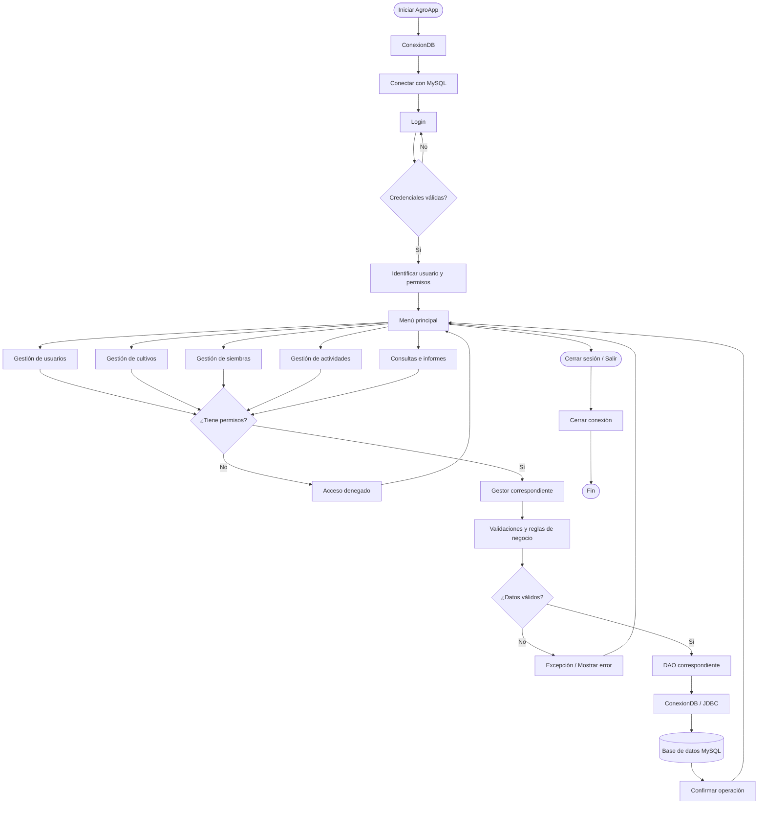
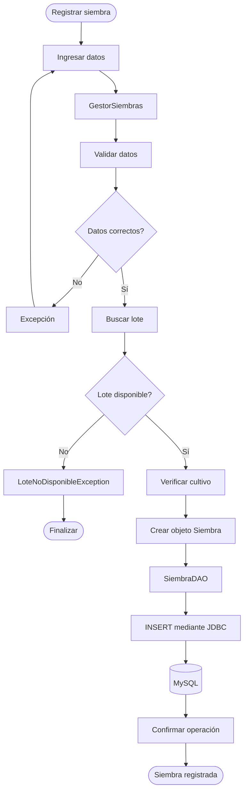

# 🌱 AgroApp

**Sistema de gestión agropecuaria desarrollado en Java.**

AgroApp es un proyecto de software orientado a la administración y gestión de establecimientos agrícolas. Su objetivo es centralizar la información relacionada con cultivos, siembras, lotes, actividades agrícolas y usuarios, facilitando la organización y el seguimiento de las operaciones del campo.

Actualmente se encuentra en desarrollo.

---

## 🚀 Tecnologías utilizadas

- **Java:** lenguaje principal.
- **JDBC:** conexión y comunicación con la base de datos.
- **MySQL:** sistema de gestión de base de datos.
- **SQL:** consultas y manipulación de datos.
- **Git & GitHub:** control de versiones.

## 🏗️ Arquitectura y conceptos aplicados

El proyecto busca aplicar los fundamentos de programación orientada a objetos y buenas prácticas de desarrollo.

- Programación orientada a objetos (POO).
- Herencia, abstracción, encapsulamiento y polimorfismo.
- Interfaces y enumeraciones (`enum`).
- Colecciones y genericidad.
- Excepciones personalizadas.
- Patrón DAO (Data Access Object).
- Persistencia de datos mediante JDBC.
- Separación de responsabilidades.

## 📋 Módulos del sistema

| Módulo | Descripción |
|---|---|
| Usuarios | Administración de usuarios y permisos. |
| Empleados | Gestión de empleados y tipos de trabajo. |
| Cultivos | Definición de cultivos y sus características. |
| Lotes | Administración de lotes agrícolas. |
| Siembras | Registro y seguimiento de siembras. |
| Actividades | Registro de riego, fertilización, fumigación y cosecha. |

## 👥 Gestión de usuarios

El sistema contempla distintos tipos de usuarios:

- **Administrador:** encargado de administrar el establecimiento y asignar permisos a los empleados.
- **Empleado:** usuario que realiza distintas tareas dentro del establecimiento.

Los permisos determinan las operaciones que cada usuario puede realizar.

### Tipos de empleados

Algunos de los roles contemplados son:

- Maquinista.
- Agrónomo.
- Encargado de riego.
- Peón rural.

## 🌾 Actividades agrícolas

El sistema contempla diferentes actividades que pueden realizarse durante el ciclo productivo:

- Riego.
- Fertilización.
- Fumigación.
- Cosecha.

Estas actividades se modelan mediante una interfaz común, permitiendo aplicar polimorfismo y extender el sistema con nuevas operaciones.

## 📊 Documentación y diagramas

### 1. Workflow general

Representa el funcionamiento general de AgroApp, desde el inicio de sesión hasta la ejecución de operaciones y su persistencia en la base de datos.



### 2. Workflow: registro de una siembra

Representa el proceso de registrar una nueva siembra, incluyendo validaciones, comprobación de disponibilidad del lote y persistencia mediante JDBC.



### 3. Arquitectura del sistema

AgroApp utiliza una separación de responsabilidades para mantener organizado el código:

| Capa | Responsabilidad |
|---|---|
| Modelo | Representación de las entidades del sistema. |
| Gestores | Lógica de negocio y reglas de funcionamiento. |
| DAO | Acceso a datos y operaciones SQL. |
| DataBase | Administración de conexiones JDBC. |
| Excepciones | Manejo de errores específicos. |
| Validaciones | Verificación de datos ingresados. |

## 📁 Estructura del proyecto

```text
AgroApp/
├── src/
│   ├── DAO/
│   ├── DataBase/
│   ├── Enum/
│   ├── Excepciones/
│   ├── Gestora/
│   ├── Modelo/
│   ├── Actividades/
│   └── Main.java
│
├── database/
│   └── agroapp.sql
│
├── .gitignore
└── README.md
```

*La estructura se irá actualizando a medida que avance el desarrollo.*

## ⚙️ Instalación y configuración

### Requisitos

- Java JDK.
- MySQL Server.
- MySQL Connector/J.
- Git.

### 1. Clonar el repositorio

```bash
git clone https://github.com/martinvallejo-torres/ArgoApp.git
```

### 2. Crear la base de datos

Crear una base de datos MySQL llamada `ArgoApp`.

### 3. Configurar las variables de entorno

Configurar las siguientes variables en el entorno local:

| Variable | Descripción |
|---|---|
| `DB_URL` | URL de conexión JDBC. |
| `DB_USER` | Usuario de MySQL. |
| `DB_PASSWORD` | Contraseña de MySQL. |

Ejemplo de URL:

```text
jdbc:mysql://localhost:3306/ArgoApp
```

En Windows PowerShell:

```powershell
$env:DB_URL="jdbc:mysql://localhost:3306/ArgoApp"
$env:DB_USER="root"
$env:DB_PASSWORD="tu_contraseña"
```

**Importante:** las credenciales no deben almacenarse directamente en el código fuente ni subirse al repositorio.

### 4. Ejecutar el proyecto

Abrir el proyecto desde el IDE, configurar las dependencias necesarias y ejecutar `Main.java`.

## 🛠️ Estado del proyecto

**En desarrollo.**

AgroApp se encuentra en una etapa inicial de desarrollo. Se irán incorporando nuevas funcionalidades y módulos progresivamente.

## 🎯 Objetivos de aprendizaje

Este proyecto también tiene como finalidad profundizar los conocimientos de Java, especialmente en:

- Diseño y modelado de clases.
- Aplicación de principios de POO.
- Gestión de datos mediante JDBC.
- Diseño de bases de datos relacionales.
- Manejo de excepciones.
- Organización y arquitectura del código.
- Aplicación de patrones de diseño.

---

**Desarrollado por:** Martin Vallejo

**Proyecto:** AgroApp

**Lenguaje:** Java
